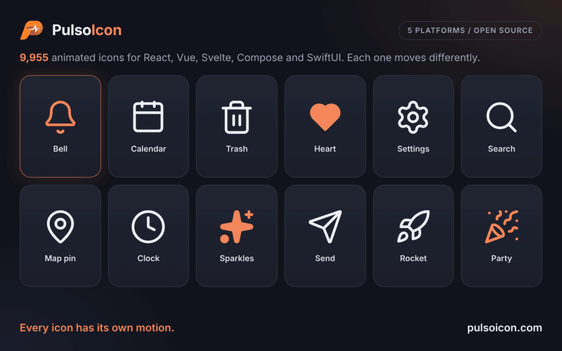

<p align="center">
  
</p>

<h1 align="center">PulsoIcon</h1>

<p align="center">
  <strong>9955 animated icons. Every one has its own motion.</strong><br />
  For React, Vue, Svelte, Jetpack Compose and SwiftUI. Icons come alive on hover; in React they replace lucide-react in one line.
</p>

<p align="center">
  <a href="https://www.npmjs.com/package/pulsoicon-react"></a>
  <a href="https://www.npmjs.com/package/pulsoicon-react"></a>
  <a href="./LICENSE"></a>
</p>

---

<p align="center">
  
</p>

A bell rings. A calendar lifts its rings. A trash can opens its lid. A clock's hand goes round.

PulsoIcon gives every icon a motion written for that icon, not one effect stamped on all of them. At rest each icon is a clean 24×24 icon; it plays when someone hovers or focuses the button, link or tab it sits in.

Every one of the 9955 motions is written for this set. About 3,700 icons are drawn here, including the line-art brand logos; the rest build on the shapes of [Lucide](https://lucide.dev), [Tabler Icons](https://tabler.io/icons) and [Iconoir](https://iconoir.com), which are credited in [LICENSE](./LICENSE).

## Why PulsoIcon

- **9955 icons, each with its own motion**:
  - **About 3,700 drawn for this set**: about 2,770 line-art brand logos (CityPulso, GitHub, Slack, Spotify, OpenAI, Claude, TikTok, VS Code, Google Drive, …, most drawn after the logos collected by [Simple Icons](https://simpleicons.org)) and around 900 other icons, including lowercase a–z, animals, sports, 3D tools and icons drawn after [Phosphor](https://phosphoricons.com).
  - **Built on open icon sets**: all 2020 [Lucide](https://lucide.dev) icons (as of 1.68), plus the shapes of [Tabler Icons](https://tabler.io/icons) (3.50, including 264 brand logos) and [Iconoir](https://iconoir.com) (7.12).
  - **3042 brand logos** in all.
- **Switch in one line** (React): same component names as lucide-react (`Calendar`, `CalendarIcon`, aliases such as `AlertCircle`) and the same props. Usually you only change the import.
- **Ships only what you use**: every icon is its own module and the package is side-effect free, so bundlers keep the icons you import and drop the rest. Three icons add about 12 kB before minification.
- **Plays where people point**: hover or focus anywhere on a button, link, label, tab or menu item and its icon plays.
- **Respects reduced motion**: nothing moves when the system asks for less motion.
- **Every platform, one source**: React, Vue, Svelte, Jetpack Compose and SwiftUI draw the same icons with the same motion and take the same props.

## Packages

One version number covers every package.

| Platform                  | Install                                                                          | Docs                                 |
| ------------------------- | -------------------------------------------------------------------------------- | ------------------------------------ |
| React 18+                 | `npm install pulsoicon-react`                                                    | [packages/react](./packages/react)   |
| Vue 3.5+                  | `npm install pulsoicon-vue`                                                      | [packages/vue](./packages/vue)       |
| Svelte 5                  | `npm install pulsoicon-svelte`                                                   | [packages/svelte](./packages/svelte) |
| Android (Jetpack Compose) | `implementation("com.citypulso:pulsoicon-compose:<version>")`                    | [kotlin](./kotlin)                   |
| iOS / macOS (SwiftUI)     | `.package(url: "https://github.com/CityPulso/PulsoIcon.git", from: "<version>")` | [swift](./swift)                     |

`pulsoicon-core` holds the icon data the web packages share; they install it for you. Until 5.2.1 the React package was called `pulsoicon`; from 6.0.1 it is `pulsoicon-react` (only the import changes).

## Quick start

React:

```tsx
import { Bell, Trash2 } from "pulsoicon-react";

<button><Bell size={20} /> Notifications</button>
<button><Trash2 color="crimson" strokeWidth={1.5} /> Delete</button>
```

Vue:

```vue
<script setup lang="ts">
import { Bell } from "pulsoicon-vue";
</script>

<template>
  <button><Bell :size="20" /> Notifications</button>
</template>
```

Svelte:

```svelte
<script lang="ts">
  import { Bell } from "pulsoicon-svelte";
</script>

<button><Bell size={20} /> Notifications</button>
```

Jetpack Compose:

```kotlin
val interactions = remember { MutableInteractionSource() }
IconButton(onClick = { /* … */ }, interactionSource = interactions) {
    PulsoIcon(PulsoIcons.Bell, contentDescription = "Notifications", interactionSource = interactions)
}
```

SwiftUI:

```swift
Button { /* … */ } label: {
    Label { Text("Notifications") } icon: { PulsoIconView(.bell, size: 20) }
}
```

Hover the button (press it, on Android) and its icon plays.

## Props

Every package takes the same props, with the same defaults and meaning (Kotlin and Swift spell the types their own way).

| Prop                  | Type               | Default        | Description                                                                                    |
| --------------------- | ------------------ | -------------- | ---------------------------------------------------------------------------------------------- |
| `size`                | `number \| string` | `24`           | Width and height                                                                               |
| `color`               | `string`           | `currentColor` | Stroke colour, and fill colour when `solid`                                                    |
| `strokeWidth`         | `number \| string` | `2`            | Stroke width on the 24-unit grid                                                               |
| `absoluteStrokeWidth` | `boolean`          | `false`        | Keep the stroke the same number of pixels at any size                                          |
| `solid`               | `boolean`          | `false`        | Filled icon instead of outline (see [Solid icons](#solid-icons))                               |
| `animated`            | `boolean`          | `true`         | `false` makes the icon fully static: nothing plays it, not even the ref or `play`              |
| `autoAnimated`        | `boolean`          | `true`         | Play the built-in hover / focus trigger. `false` turns that off; the ref and `play` still work |
| `play`                | `boolean`          |                | `true` plays the motion, `false` returns to rest. Works with or without `autoAnimated`         |

On the web, any other SVG attribute (`className` / `class`, `style`, `aria-label`, …) is passed to the `<svg>`. Icons render with `aria-hidden="true"`; give the surrounding button or link a label.

## When the animation plays

On the web, an icon plays when the pointer enters, or focus moves into, its closest `button`, `a`, `label`, `summary`, `[role="button"]`, `[role="link"]`, `[role="tab"]` or `[role="menuitem"]`. If there is none, the icon plays on its own hover.

Any other element can become the trigger with `data-icon-trigger`:

```tsx
<div className="card" data-icon-trigger>
  <MapPin /> 3 venues near you
</div>
```

On Android the icon plays with the control whose `interactionSource` you pass; on Apple platforms, while a pointer hovers it. Everywhere, `play` and the handle (`ref`, `bind:this`, `rememberPulsoIconHandle()`, `PulsoIconHandle`) play it from code, and nothing moves when the system asks for reduced motion.

## Solid icons

`solid` draws the filled version of an icon, in `color`:

```tsx
<Heart solid color="crimson" />
```

About 1,700 icons have a filled drawing taken from the [Tabler](https://tabler.io/icons) filled set or the [Phosphor](https://phosphoricons.com) fill weight. Their source file has a `solid` list and a "Solid from …" comment. The other icons fill their closed outline shapes and cut their inner lines out of the fill, so the details stay visible. Motions that draw a stroke on (`draw`, `redraw`, …) pop in instead on filled shapes.

## Finding icons

### Other names

Icons also answer to the names other icon sets use: `Gear` is `Settings`, `Magnifier` is `Search`, `Cart` is `ShoppingCart`, `World` is `Globe`, `DotsHorizontal` is `Ellipsis`, and so on. Every icon is also exported with an `Icon` suffix (`BellIcon`).

### Brand logos

Brand icons start with `Brand` (`BrandGithub`, `BrandSlack`, `BrandOpenai`, …). The brands added up to 3.1 are also exported without the prefix (`Github`, `Slack`); the ones added in 4.0 only with it, because many brand names are ordinary words. They are simplified line drawings made for this set, most of the newer ones drawn after the logos collected by [Simple Icons](https://simpleicons.org).

All product names, logos and brands are the property of their respective owners and are used here only to refer to those products or services. Their use does not imply endorsement. Follow each brand's own guidelines when you use its logo.

### All icons at once

Every icon also has a kebab-case name (`party-popper`), the same on every platform, for storing on your data. The web packages export `ICONS` / `ICON_NAMES` from `<package>/all`, the names alone from `<package>/names` and one icon from `<package>/icons/<name>`; Compose has `PulsoIcons.byKey("party-popper")` and SwiftUI `PulsoIcon.byKey("party-popper")`.

## Report a wrong icon

If an icon is drawn wrong, a brand logo doesn't match the real one, or a motion looks off, please email
**citypulso@gmail.com** with the icon name (for example `brand-avianca`) and, if you can, a screenshot or a link
to the correct logo. Issues on GitHub are welcome too.

## Contributing

```bash
npm install
npm run gen              # writes every platform's icon files from packages/core
npm run preview:react    # gallery of every icon, http://localhost:10205
npm run preview:vue      # the same gallery in Vue, http://localhost:10206
npm run preview:svelte   # and in Svelte, http://localhost:10207
npm test
npm run build
```

Each icon is one data file in `packages/core/src/icons/<name>.ts`, shared by every platform: the shapes of the icon and, for each shape, an optional motion (`r` recipe from `packages/core/src/recipes.ts`, `d` delay, `x`/`y` direction, `a` amplitude, `o` pivot point on the 24×24 grid). Edit that file to change how an icon moves, then run `npm run gen`. Other names live in `packages/core/src/aliases.ts`.

| Folder                                              | What                                                                               |
| --------------------------------------------------- | ---------------------------------------------------------------------------------- |
| `packages/core`                                     | `pulsoicon-core`: the icons, recipes, solid drawings and the framework-free player |
| `packages/react`, `packages/vue`, `packages/svelte` | The web packages; their icon files are generated                                   |
| `kotlin/`                                           | The Android library (Gradle); `icons/` is generated and committed                  |
| `swift/` and `Package.swift`                        | The Swift package; `Icons/` is generated and committed                             |
| `preview/`                                          | The three galleries; `preview/shared` holds what they share                        |

The Kotlin and Swift recipes are written by hand; their tests check them against `packages/core` (`kotlin/`: `./gradlew :pulsoicon:testDebugUnitTest`; Swift: `swift test`). `npm run test:browser` plays icons in Chromium through React, Vue and Svelte side by side and checks that they move the same.

### Releasing

`package.json` at the root holds the one version of every package. `npm run set-version -- 6.1.0` sets it everywhere; push that to `main` and CI publishes the npm packages and the Maven artifact that are not out yet, then tags `6.1.0` for Swift Package Manager.

## License

PulsoIcon is open source under the [ISC license](./LICENSE) © CityPulso.

### What is ours, and what comes from other icon sets

| Part                                                                        | Origin                                                                           |
| --------------------------------------------------------------------------- | -------------------------------------------------------------------------------- |
| Every animation (how each icon moves)                                       | Written for PulsoIcon                                                            |
| Runtime code (every package's components, triggers, motion recipes)         | Written for PulsoIcon                                                            |
| About 3,700 icons, including about 2,770 line-art brand logos               | Drawn for PulsoIcon                                                              |
| Shapes of the 2020 Lucide icons                                             | Based on [Lucide](https://lucide.dev) (ISC; some derived from Feather, MIT)      |
| Shapes of the icons marked "Adapted from Tabler Icons"                      | Based on [Tabler Icons](https://tabler.io/icons) (MIT)                           |
| Shapes of the icons marked "Adapted from Iconoir"                           | Based on [Iconoir](https://iconoir.com) (MIT)                                    |
| Five icons marked "Adapted from Hugeicons"                                  | Adapted from [Hugeicons](https://hugeicons.com) (MIT)                            |
| Icons marked "Drawn after Phosphor Icons"                                   | Redrawn after [Phosphor](https://phosphoricons.com) shapes (MIT)                 |
| Solid shapes marked "Solid from Tabler Icons" / "Solid from Phosphor Icons" | Taken from the Tabler filled set and the Phosphor fill weight (MIT)              |
| Brand icons marked "Drawn after Simple Icons"                               | Drawn after the logos collected by [Simple Icons](https://simpleicons.org) (CC0) |

Icons based on or drawn after Tabler Icons, Iconoir, Hugeicons, Phosphor or Simple Icons name their source in a comment at the top of their file; the Lucide icons keep their Lucide names. The full license texts are in [LICENSE](./LICENSE).

### Using PulsoIcon in your project

You may use PulsoIcon freely, including in commercial and closed-source products. The one condition, from ISC and the MIT licenses of the sets above, is the notice:

- **If you ship PulsoIcon** (in an app, a website bundle, a template or a library of your own), include PulsoIcon's [LICENSE](./LICENSE) file with it, for example on your "open-source licenses" or "third-party notices" page or in a `THIRD_PARTY_NOTICES` file. It already contains the notices of Lucide, Tabler Icons, Iconoir, Hugeicons and Phosphor.
- **If you copy or modify icons** from PulsoIcon into your own set, keep the source comment at the top of each file, and keep the LICENSE notices.
- You don't have to credit PulsoIcon inside your product's interface, although a link is always appreciated.

Brand logos are trademarks of their owners. Using a brand icon doesn't imply endorsement, and you should follow each brand's own guidelines.
