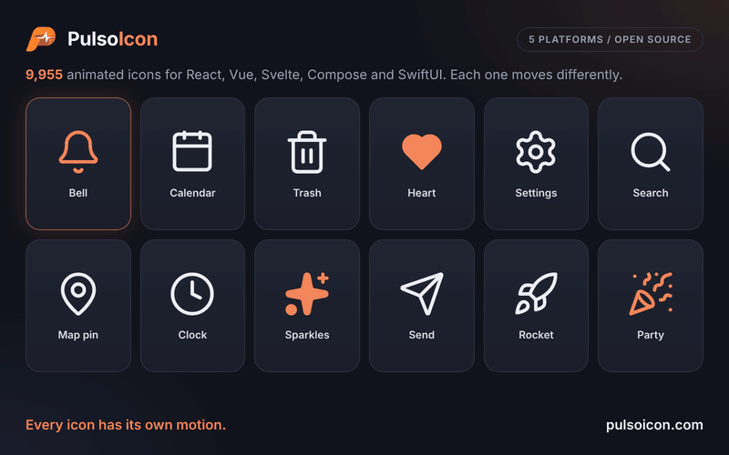

<p align="center">
  
</p>

<h1 align="center">PulsoIcon for Angular</h1>

<p align="center"><a href="https://pulsoicon.com"><strong>pulsoicon.com</strong></a>: browse all icons, try them live and copy the code</p>

<p align="center">
  <strong>9955 animated icons. Every one has its own motion.</strong>
</p>

<p align="center">
  <a href="https://www.npmjs.com/package/pulsoicon-angular"></a>
  <a href="https://github.com/CityPulso/PulsoIcon-Package/blob/main/LICENSE"></a>
</p>

---

<p align="center">
  
</p>

Angular icons that play their own motion when someone hovers or focuses the button, link or tab they sit in. One standalone component draws any icon, and each icon is a small data object you import, so your bundle holds only the icons you use. They render exactly the same `<svg>` as `pulsoicon-react` and move the same way.

## Install

```bash
npm install pulsoicon-angular
```

Works with Angular 19 or newer. The package is built with ng-packagr in the Angular Package Format (partial Ivy), so the Angular CLI links it like any other library. [Motion](https://motion.dev) (12 or newer) plays the icons; npm installs it for you.

## Quick start

```ts
import { Component } from "@angular/core";
import { Bell, Calendar, PulsoIconComponent, Trash2 } from "pulsoicon-angular";

@Component({
  selector: "app-toolbar",
  imports: [PulsoIconComponent],
  template: `
    <button><pulso-icon [icon]="Bell" size="20" /> Notifications</button>
    <button><pulso-icon [icon]="Calendar" /> Schedule</button>
    <button><pulso-icon [icon]="Trash2" color="crimson" strokeWidth="1.5" /> Delete</button>
  `,
})
export class Toolbar {
  protected readonly Bell = Bell;
  protected readonly Calendar = Calendar;
  protected readonly Trash2 = Trash2;
}
```

Hover a button and its icon plays. `<pulso-icon>` takes no room of its own (`display: contents`): the `<svg>` inside it sits in your layout directly.

### On your own `<svg>`

The `pulsoIcon` directive draws an icon into an `<svg>` you write, keeping your attributes, classes and styles:

```html
<svg pulsoIcon [icon]="Bell" size="20" class="toolbar-icon"></svg>
```

Import `PulsoIconDirective` for it. Both share one engine and take the same inputs.

## Inputs

The same names, defaults and meaning as in every PulsoIcon package.

| Input                 | Type               | Default        | Description                                                                                       |
| --------------------- | ------------------ | -------------- | ------------------------------------------------------------------------------------------------- |
| `icon`                | `IconData`         | required       | The icon to draw (`Bell`, `Trash2`, … from `pulsoicon-angular`)                                   |
| `size`                | `number \| string` | `24`           | Width and height                                                                                  |
| `color`               | `string`           | `currentColor` | Stroke colour, and fill colour when `solid`                                                       |
| `strokeWidth`         | `number \| string` | `2`            | Stroke width on the 24-unit grid                                                                  |
| `absoluteStrokeWidth` | `boolean`          | `false`        | Keep the stroke the same number of pixels at any size                                             |
| `solid`               | `boolean`          | `false`        | Filled icon instead of outline                                                                    |
| `animated`            | `boolean`          | `true`         | `false` makes the icon fully static: nothing plays it, not even the handle or `play`              |
| `autoAnimated`        | `boolean`          | `true`         | Play the built-in hover / focus trigger. `false` turns that off; the handle and `play` still work |
| `play`                | `boolean`          |                | `true` plays the motion, `false` returns to rest. Works with or without `autoAnimated`            |
| `label`               | `string`           |                | Accessible name: the icon becomes `role="img"` with this label                                    |

Boolean inputs accept attributes too (`<pulso-icon [icon]="Heart" solid />`). Without `label`, icons render with `aria-hidden="true"`; give the surrounding button or link a label, or set `label` on an icon that stands alone.

## When the animation plays

An icon plays when the pointer enters, or focus moves into, its closest `button`, `a`, `label`, `summary`, `[role="button"]`, `[role="link"]`, `[role="tab"]` or `[role="menuitem"]`. If there is none, the icon plays on its own hover. Any other element becomes the trigger with `data-icon-trigger`. Nothing moves when the system asks for reduced motion.

### Play from code

A template reference (`#check="pulsoIcon"`) or `viewChild(PulsoIconComponent)` gives `startAnimation()` and `stopAnimation()`; both return a promise that resolves when the motion has finished. Set `[autoAnimated]="false"` when only your code should decide when it plays:

```html
<button (click)="check.startAnimation()"><pulso-icon #check="pulsoIcon" [icon]="Check" [autoAnimated]="false" /> Save</button>
```

Or drive it from a signal: `<pulso-icon [icon]="Bell" [autoAnimated]="false" [play]="hasNewMessage()" />`.

## Server rendering

Icons render on the server (Angular SSR and prerendering) without touching `window` or `document`. The motion starts in the browser after the first render. The `<pulso-icon>` host is marked `ngSkipHydration`, so the client redraws its `<svg>` instead of hydrating it.

## Solid icons

`solid` draws the filled version of an icon, in `color`. About 1,700 icons have a filled drawing; the others fill their closed shapes and cut their inner lines out of the fill.

## Finding icons

Names follow lucide (`Calendar`, `Trash2`), every icon is also exported with an `Icon` suffix (`BellIcon`), and other icon sets' names work too (`Gear` is `Settings`, Tabler's `IconHome` is `Home`). Brand logos start with `Brand` (`BrandGithub`). Browse them all in the [repository README](https://github.com/CityPulso/PulsoIcon-Package#finding-icons).

There is no global icon registry: import the icons you use and pass them to `[icon]`. For icon pickers, `pulsoicon-angular/all` exports `ICONS`, every icon by its kebab-case name (all 9955 of them, so only where you need the full set), and `pulsoicon-angular/names` lists the names without loading any icon:

```ts
import { ICON_NAMES } from "pulsoicon-angular/names";

const load = async (name: string) => (await import("pulsoicon-angular/all")).ICONS[name];
```

## Styling

Each icon renders `<svg class="pulsoicon pulsoicon-<name>">`, so CSS can target every icon (`.pulsoicon`) or one (`.pulsoicon-bell`). The component uses no view encapsulation, so global styles reach the `<svg>`.

## Other platforms

The same icons, props and motion: [React, Vue, Svelte, Solid, Preact, Angular, Astro, Android (Jetpack Compose) and iOS (SwiftUI)](https://github.com/CityPulso/PulsoIcon-Package#packages).

## License

ISC © CityPulso. Some icon shapes come from Lucide, Tabler Icons, Iconoir, Hugeicons and Phosphor; ship the [LICENSE](https://github.com/CityPulso/PulsoIcon-Package/blob/main/LICENSE) file with your app. What comes from where is listed in the [repository README](https://github.com/CityPulso/PulsoIcon-Package#license).
