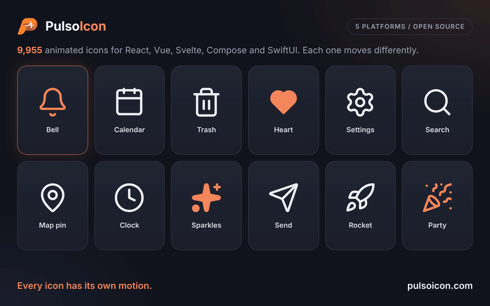

  

<h1 align="center">pulsoicon-core</h1>

  <strong>9955 animated icons. Every one has its own motion.</strong>

  
  

---

  

The data every PulsoIcon package is built from: the 9955 icons (their shapes and the motion of each shape), the 35 motion recipes, the solid drawings and the other names icons answer to. It has no framework in it.

**You normally don't install this package yourself.** `pulsoicon-react`, `pulsoicon-vue` and `pulsoicon-svelte` depend on it and install it for you. Use it directly to build PulsoIcon for another framework, or to read the icon data.

## What is in it

| Import                        | What                                                                                                                                                                |
| ----------------------------- | ------------------------------------------------------------------------------------------------------------------------------------------------------------------- |
| `pulsoicon-core`              | Types (`IconData`, `IconNode`, `IconMotion`, …), `RECIPES` / `RECIPE_NAMES`, `ALIASES`, `solidNodes()` and the path geometry helpers                                |
| `pulsoicon-core/icons/<name>` | One icon's data, e.g. `import { Bell } from "pulsoicon-core/icons/bell"`                                                                                            |
| `pulsoicon-core/all`          | Every icon's data by kebab-case name (`ICONS`, `ICON_NAMES`)                                                                                                        |
| `pulsoicon-core/names`        | Every icon name, without loading any icon                                                                                                                           |
| `pulsoicon-core/frame`        | `iconFrame(data, options)`: the resting `<svg>` as a plain element tree, exactly what the React package renders                                                     |
| `pulsoicon-core/dom`          | `playIcon(svg, frame, options)`: plays an icon rendered from that tree with [Motion](https://motion.dev)'s `animate()` (Motion is then needed as a peer dependency) |

`pulsoicon-vue` and `pulsoicon-svelte` are each a thin component around `iconFrame` and `playIcon`; [their source](https://github.com/CityPulso/PulsoIcon/tree/main/packages) shows how to wrap them.

## License

ISC © CityPulso. Some icon shapes come from Lucide, Tabler Icons, Iconoir, Hugeicons and Phosphor; see [LICENSE](https://github.com/CityPulso/PulsoIcon/blob/main/LICENSE) and the [repository README](https://github.com/CityPulso/PulsoIcon#license).
