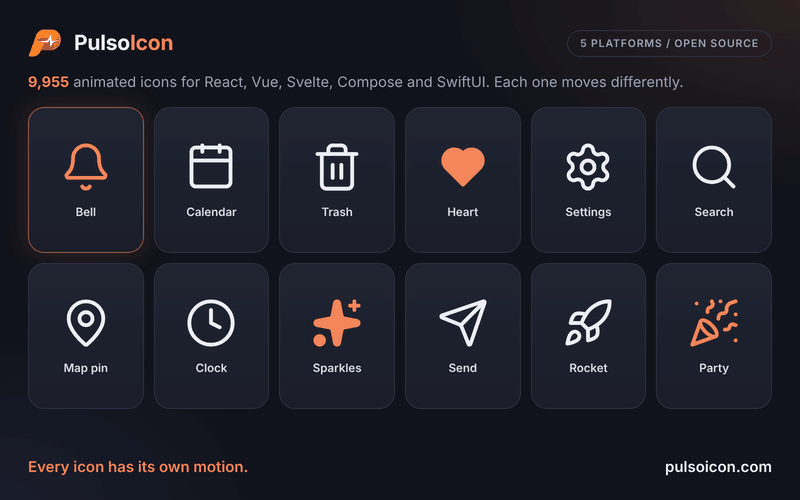

<p align="center">
  
</p>

<h1 align="center">PulsoIcon</h1>

<p align="center">
  <strong>9955 animated icons. Every one has its own motion.</strong><br />
  React icons that come alive on hover. A drop-in replacement for lucide-react.
</p>

<p align="center">
  <a href="https://www.npmjs.com/package/pulsoicon-react"></a>
  <a href="https://www.npmjs.com/package/pulsoicon-react"></a>
  <a href="https://github.com/CityPulso/PulsoIcon/blob/main/LICENSE"></a>
</p>

---

<p align="center">
  
</p>

A bell rings. A calendar lifts its rings. A trash can opens its lid. A clock's hand goes round.

PulsoIcon gives every icon a motion written for that icon, not one effect stamped on all of them. At rest each icon is a clean 24×24 icon; it plays when someone hovers or focuses the button, link or tab it sits in.

Every one of the 9955 motions is written for this set. About 3,700 icons are drawn here, including the line-art brand logos; the rest build on the shapes of [Lucide](https://lucide.dev), [Tabler Icons](https://tabler.io/icons) and [Iconoir](https://iconoir.com), which are credited in [LICENSE](https://github.com/CityPulso/PulsoIcon/blob/main/LICENSE).

## Why PulsoIcon

- **9955 icons, each with its own motion**:
  - **About 3,700 drawn for this set**: about 2,770 line-art brand logos (CityPulso, GitHub, Slack, Spotify, OpenAI, Claude, TikTok, VS Code, Google Drive, …, most drawn after the logos collected by [Simple Icons](https://simpleicons.org)) and around 900 other icons, including lowercase a–z, animals, sports, 3D tools and icons drawn after [Phosphor](https://phosphoricons.com).
  - **Built on open icon sets**: all 2020 [Lucide](https://lucide.dev) icons (as of 1.68), plus the shapes of [Tabler Icons](https://tabler.io/icons) (3.50, including 264 brand logos) and [Iconoir](https://iconoir.com) (7.12).
  - **3042 brand logos** in all.
- **Switch in one line**: same component names as lucide-react (`Calendar`, `CalendarIcon`, aliases such as `AlertCircle`) and the same props. Usually you only change the import.
- **Ships only what you use**: every icon is its own module and the package is side-effect free, so bundlers keep the icons you import and drop the rest. Three icons add about 12 kB before minification.
- **Plays where people point**: hover or focus anywhere on a button, link, label, tab or menu item and its icon plays.
- **Respects reduced motion**: nothing moves when the system asks for less motion.
- **Two dependencies**: React and [Motion](https://motion.dev), plus `pulsoicon-core`, the icon data every PulsoIcon package shares.

## Install

```bash
npm install pulsoicon-react
```

Works with React 18 or newer. [Motion](https://motion.dev) (12 or newer) is installed for you; if your app already uses Motion, PulsoIcon shares that copy.

The same icons, props and motion are also available for [Vue, Svelte, Android and iOS](https://github.com/CityPulso/PulsoIcon#packages).

## Quick start

```tsx
import { Bell, Calendar, Trash2 } from "pulsoicon-react";

export function Toolbar() {
  return (
    <>
      <button>
        <Bell size={20} /> Notifications
      </button>
      <button>
        <Calendar /> Schedule
      </button>
      <button>
        <Trash2 color="crimson" strokeWidth={1.5} /> Delete
      </button>
    </>
  );
}
```

Hover a button and its icon plays.

### Coming from lucide-react

```diff
- import { Bell, Calendar, Trash2 } from "lucide-react";
+ import { Bell, Calendar, Trash2 } from "pulsoicon-react";
```

Icon components and their props work the same. Lucide's helpers (`createLucideIcon`, `LucideProvider`, the `icons` object) are not included.

### Coming from `pulsoicon` 5.x

The React package was called `pulsoicon` until 5.2.1. From 6.0.1 it is `pulsoicon-react`, next to `pulsoicon-vue` and `pulsoicon-svelte`; nothing else changed:

```diff
- import { Bell } from "pulsoicon";
+ import { Bell } from "pulsoicon-react";
```

### Coming from Tabler

Tabler icon names work too, without the `Icon` prefix: `IconMoodSad` is `MoodSad`, `IconHome` is `Home`, `IconBrandGithub` is `BrandGithub`. Where Lucide already has the icon, the Tabler name points to it (`Home` is `House`), and Tabler families follow Lucide's naming (`HomeDollar` is `HouseDollar`, `PhotoEdit` is `ImageEdit`).

## Props

| Prop                  | Type               | Default        | Description                                                                                    |
| --------------------- | ------------------ | -------------- | ---------------------------------------------------------------------------------------------- |
| `size`                | `number \| string` | `24`           | Width and height                                                                               |
| `color`               | `string`           | `currentColor` | Stroke colour, and fill colour when `solid`                                                    |
| `strokeWidth`         | `number \| string` | `2`            | Stroke width on the 24-unit grid                                                               |
| `absoluteStrokeWidth` | `boolean`          | `false`        | Keep the stroke the same number of pixels at any size                                          |
| `solid`               | `boolean`          | `false`        | Filled icon instead of outline (see [Solid icons](#solid-icons))                               |
| `animated`            | `boolean`          | `true`         | `false` makes the icon fully static: nothing plays it, not even the ref or `play`              |
| `autoAnimated`        | `boolean`          | `true`         | Play the built-in hover / focus trigger. `false` turns that off; the ref and `play` still work |
| `play`                | `boolean`          |                | `true` plays the motion, `false` returns to rest. Works with or without `autoAnimated`         |

`autoAnimated` and `play` only exist while the icon can animate, so TypeScript rejects `<Bell animated={false} play />`. Wrapper components that drop a prop should use the exported `DistributiveOmit<IconProps, "size">` instead of `Omit`, which would lose that check.

Any other SVG attribute (`className`, `style`, `aria-label`, …) is passed to the `<svg>`. Icons render with `aria-hidden="true"`; give the surrounding button or link a label.

## When the animation plays

An icon plays when the pointer enters, or focus moves into, its closest `button`, `a`, `label`, `summary`, `[role="button"]`, `[role="link"]`, `[role="tab"]` or `[role="menuitem"]`. If there is none, the icon plays on its own hover.

Any other element can become the trigger with `data-icon-trigger`:

```tsx
<div className="card" data-icon-trigger>
  <MapPin /> 3 venues near you
</div>
```

### Play from code

Every icon forwards a ref with `startAnimation()` and `stopAnimation()`. Both return a promise that resolves when the motion has finished, so you can `await check.current?.startAnimation()` before moving on. Set `autoAnimated={false}` when only your code should decide when it plays:

```tsx
import type { IconHandle } from "pulsoicon-react";

import { useRef } from "react";
import { Check } from "pulsoicon-react";

function SaveButton() {
  const check = useRef<IconHandle>(null);
  return (
    <button onClick={() => check.current?.startAnimation()}>
      <Check autoAnimated={false} ref={check} /> Save
    </button>
  );
}
```

Or drive it from state with `play`. The motion starts when `play` turns `true` and returns to rest when it turns `false`:

```tsx
<Bell autoAnimated={false} play={hasNewMessage} />
```

`animated={false}` keeps an icon completely still; the ref and `play` do nothing.

## Solid icons

`solid` draws the filled version of an icon, in `color`:

```tsx
<Heart solid color="crimson" />
```

About 1,700 icons have a filled drawing taken from the [Tabler](https://tabler.io/icons) filled set or the [Phosphor](https://phosphoricons.com) fill weight. Their source file has a `solid` list and a "Solid from …" comment. The other icons fill their closed outline shapes and cut their inner lines out of the fill, so the details stay visible. Motions that draw a stroke on (`draw`, `redraw`, …) pop in instead on filled shapes.

## Finding icons

### Other names

Icons also answer to the names other icon sets use: `Gear` is `Settings`, `Magnifier` is `Search`, `Cart` is `ShoppingCart`, `World` is `Globe`, `DotsHorizontal` is `Ellipsis`, and so on. Every icon is also exported with an `Icon` suffix (`BellIcon`).

### Brand logos

Brand icons start with `Brand` (`BrandGithub`, `BrandSlack`, `BrandOpenai`, …). The brands added up to 3.1 are also exported without the prefix (`Github`, `Slack`); the ones added in 4.0 only with it, because many brand names are ordinary words. They are simplified line drawings made for this set, most of the newer ones drawn after the logos collected by [Simple Icons](https://simpleicons.org).

All product names, logos and brands are the property of their respective owners and are used here only to refer to those products or services. Their use does not imply endorsement. Follow each brand's own guidelines when you use its logo.

### All icons at once

For icon pickers and galleries, `pulsoicon-react/all` exports every icon by its kebab-case name. It pulls in all 9955 icons, so use it only where you need the full set:

```tsx
import { ICON_NAMES, ICONS } from "pulsoicon-react/all";

const Icon = ICONS["party-popper"];
```

One icon can also be imported by path: `import { Calendar } from "pulsoicon-react/icons/calendar"`. To list the names without loading any icon (to build a picker that loads icons on demand), use `pulsoicon-react/names`:

```tsx
import type { IconName } from "pulsoicon-react/names";

import { ICON_NAMES } from "pulsoicon-react/names";

const load = (name: IconName) => import(`pulsoicon-react/icons/${name}`);
```

## Styling

Each icon renders `<svg class="pulsoicon pulsoicon-<name>">`, so CSS can target every icon or a single one:

```css
.pulsoicon {
  vertical-align: -0.125em;
}

.pulsoicon-bell {
  color: #f2552c;
}
```

## Report a wrong icon

If an icon is drawn wrong, a brand logo doesn't match the real one, or a motion looks off, please email
**citypulso@gmail.com** with the icon name (for example `brand-avianca`) and, if you can, a screenshot or a link
to the correct logo. Issues on GitHub are welcome too.

## License

ISC © CityPulso. Some icon shapes come from Lucide, Tabler Icons, Iconoir, Hugeicons and Phosphor; ship the
[LICENSE](https://github.com/CityPulso/PulsoIcon/blob/main/LICENSE) file with your app. What comes from where is listed in the
[repository README](https://github.com/CityPulso/PulsoIcon#license).
