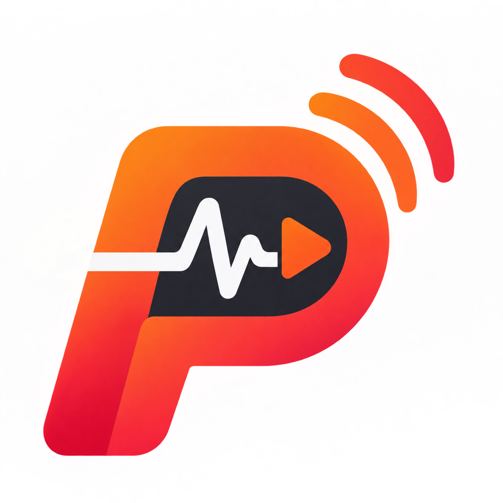
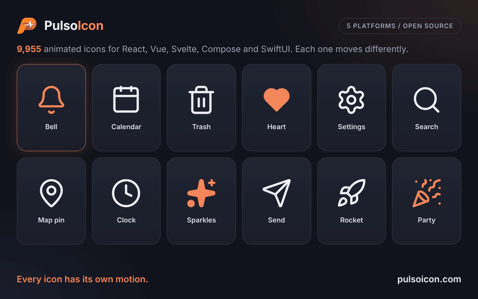

<p align="center">
  
</p>

<h1 align="center">PulsoIcon for Vue</h1>

<p align="center"><a href="https://pulsoicon.com"><strong>pulsoicon.com</strong></a>: browse all icons, try them live and copy the code</p>

<p align="center">
  <strong>9955 animated icons. Every one has its own motion.</strong>
</p>

<p align="center">
  <a href="https://www.npmjs.com/package/pulsoicon-vue"></a>
  <a href="https://github.com/CityPulso/PulsoIcon-Package/blob/main/LICENSE"></a>
</p>

---

<p align="center">
  
</p>

Vue 3.5+ icons that play their own motion when someone hovers or focuses the button, link or tab they sit in. They render exactly the same `<svg>` as `pulsoicon-react` and move the same way.

## Install

```bash
npm install pulsoicon-vue
```

Works with Vue 3.5 or newer. [Motion](https://motion.dev) (12 or newer) plays the icons; npm installs it for you.

## Quick start

```vue
<script setup lang="ts">
import { Bell, Calendar, Trash2 } from "pulsoicon-vue";
</script>

<template>
  <button><Bell :size="20" /> Notifications</button>
  <button><Calendar /> Schedule</button>
  <button><Trash2 color="crimson" :stroke-width="1.5" /> Delete</button>
</template>
```

Hover a button and its icon plays. Props work in camelCase or kebab-case (`:stroke-width`, `:auto-animated`).

## Props

The same names, defaults and meaning as in every PulsoIcon package.

| Prop                  | Type               | Default        | Description                                                                                    |
| --------------------- | ------------------ | -------------- | ---------------------------------------------------------------------------------------------- |
| `size`                | `number \| string` | `24`           | Width and height                                                                               |
| `color`               | `string`           | `currentColor` | Stroke colour, and fill colour when `solid`                                                    |
| `strokeWidth`         | `number \| string` | `2`            | Stroke width on the 24-unit grid                                                               |
| `absoluteStrokeWidth` | `boolean`          | `false`        | Keep the stroke the same number of pixels at any size                                          |
| `solid`               | `boolean`          | `false`        | Filled icon instead of outline                                                                 |
| `animated`            | `boolean`          | `true`         | `false` makes the icon fully static: nothing plays it, not even the ref or `play`              |
| `autoAnimated`        | `boolean`          | `true`         | Play the built-in hover / focus trigger. `false` turns that off; the ref and `play` still work |
| `play`                | `boolean`          |                | `true` plays the motion, `false` returns to rest. Works with or without `autoAnimated`         |

Any other attribute (`class`, `style`, `aria-label`, …) goes on the `<svg>`. Icons render with `aria-hidden="true"`; give the surrounding button or link a label.

## When the animation plays

An icon plays when the pointer enters, or focus moves into, its closest `button`, `a`, `label`, `summary`, `[role="button"]`, `[role="link"]`, `[role="tab"]` or `[role="menuitem"]`. If there is none, the icon plays on its own hover. Any other element becomes the trigger with `data-icon-trigger`. Nothing moves when the system asks for reduced motion.

### Play from code

A template ref gives `startAnimation()` and `stopAnimation()`; both return a promise that resolves when the motion has finished. Set `:auto-animated="false"` when only your code should decide when it plays:

```vue
<script setup lang="ts">
import type { IconHandle } from "pulsoicon-vue";

import { Check } from "pulsoicon-vue";
import { ref } from "vue";

const check = ref<IconHandle>();
</script>

<template>
  <button @click="check?.startAnimation()"><Check ref="check" :auto-animated="false" /> Save</button>
</template>
```

Or drive it from state: `<Bell :auto-animated="false" :play="hasNewMessage" />`.

## Solid icons

`solid` draws the filled version of an icon, in `color`. About 1,700 icons have a filled drawing; the others fill their closed shapes and cut their inner lines out of the fill.

## Finding icons

Names follow lucide-react (`Calendar`, `Trash2`), every icon is also exported with an `Icon` suffix (`BellIcon`), and other icon sets' names work too (`Gear` is `Settings`, Tabler's `IconHome` is `Home`). Brand logos start with `Brand` (`BrandGithub`). Browse them all in the [repository README](https://github.com/CityPulso/PulsoIcon-Package#finding-icons).

For icon pickers, `pulsoicon-vue/all` exports every icon by its kebab-case name (all 9955 of them, so only where you need the full set). `pulsoicon-vue/names` lists the names without loading any icon, and `pulsoicon-vue/icons/<name>` loads one:

```ts
import type { IconName } from "pulsoicon-vue/names";

import { ICON_NAMES } from "pulsoicon-vue/names";

const load = (name: IconName) => import(`pulsoicon-vue/icons/${name}`);
```

## Styling

Each icon renders `<svg class="pulsoicon pulsoicon-<name>">`, so CSS can target every icon (`.pulsoicon`) or one (`.pulsoicon-bell`).

## Other platforms

The same icons, props and motion: [React, Vue, Svelte, Solid, Preact, Angular, Astro, Android (Jetpack Compose) and iOS (SwiftUI)](https://github.com/CityPulso/PulsoIcon-Package#packages).

## License

ISC © CityPulso. Some icon shapes come from Lucide, Tabler Icons, Iconoir, Hugeicons and Phosphor; ship the [LICENSE](https://github.com/CityPulso/PulsoIcon-Package/blob/main/LICENSE) file with your app. What comes from where is listed in the [repository README](https://github.com/CityPulso/PulsoIcon-Package#license).
